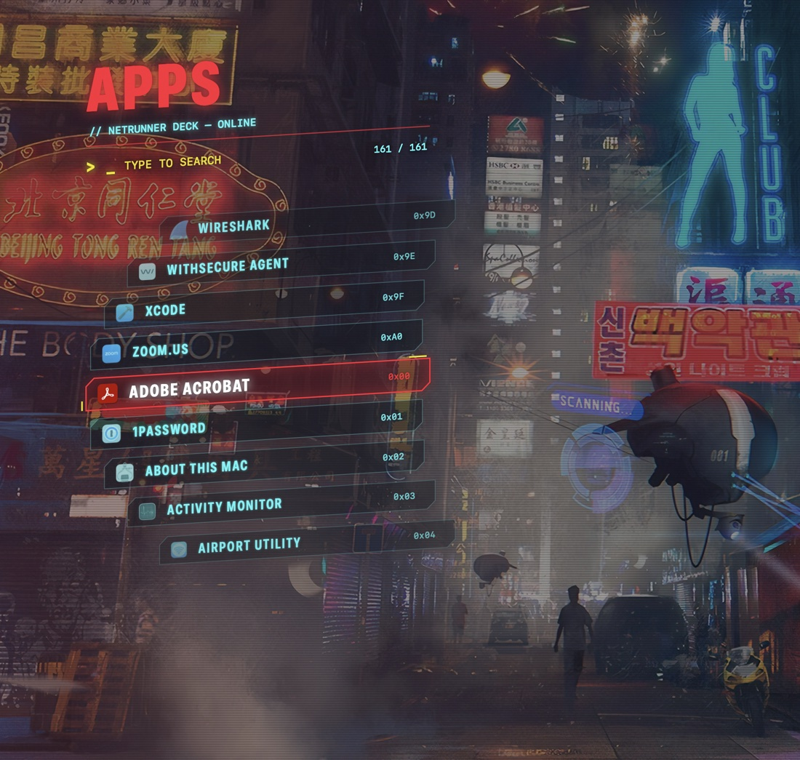
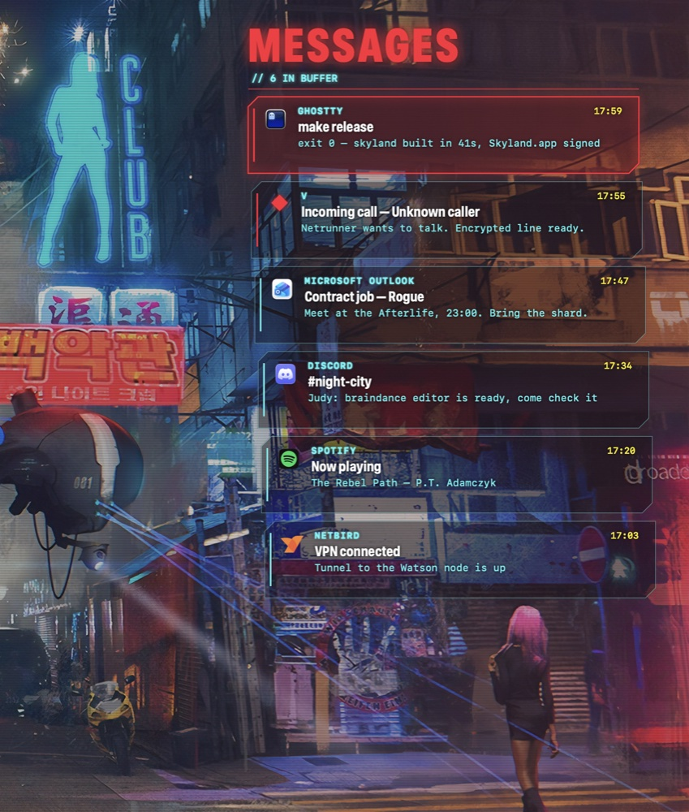
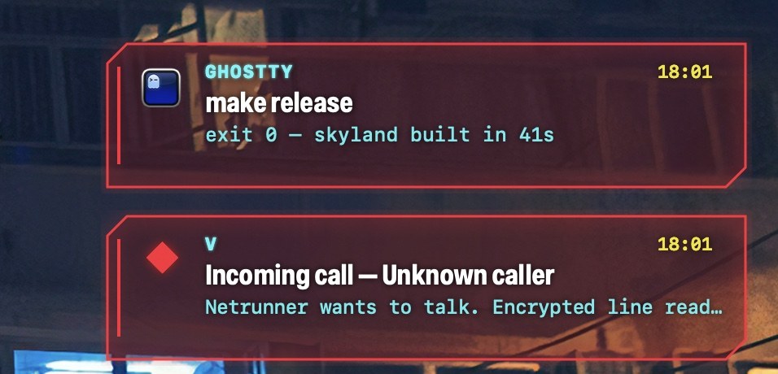

# skyland-cyberdeck

Cyberpunk HUD pieces for macOS: neon red / cyan, cut corners, glow, scanlines and
flicker. Made for [skyland](https://github.com/waxdred/skyland) (a Hyprland-like
tiling window manager for macOS), works on its own with any window manager.

<p align="center"></p>

## Apps launcher

```sh
skyland-cyberdeck launcher   # toggle
```

- a curved column of apps around the selection, wrapping like a wheel
- type to search (prefix, word start, substring, then fuzzy), apps you launch often come first
- `↑` `↓` or scroll to move, `return` or click to launch, `esc` or a click outside to close
- an eye implant overlay: opens on the screen under the mouse, which stays visible behind a light tint and scanlines

Apps come from `/Applications` (and one folder down), `/System/Applications`,
their `Utilities`, `/System/Library/CoreServices/Applications` and `~/Applications`.

## HUD

```sh
skyland-cyberdeck hud   # toggle
```

A deck on the right of the screen under the mouse, with real data only:

- **clock** (24 h or 12 h, seconds, a second time zone) and **calendar** (today
  highlighted, `←` `→` change the month, the locale's week start or yours)
- **herdr agents**: sessions, running, waiting for you, idle, the active ones
  (`pane.list` on the herdr socket, no `herdr` process started); `UNAVAILABLE` when
  herdr is not running
- **connections**: Wi-Fi (on / off switch; click it for the networks this Mac knows,
  click one to join it), Bluetooth (click it for the paired devices, click one to
  connect or disconnect it), AirDrop. The current network name and networks never
  joined need the Location permission: "Settings…" opens Wi-Fi settings for those.
- **display & sound**: built-in display brightness, output volume and mute, output
  device; the sliders change the real values
- **system**: CPU (all cores) and RAM (used like Activity Monitor: app + wired +
  compressed) with history, network throughput of the default interface, startup
  disk, battery (time left only when macOS estimates it)
- **messages** (the last two) and **quick launch** apps

Hovering lights up what can be clicked: a card opens its app (Clock, Calendar, Activity
Monitor, the terminal for herdr, the messages panel, Sound settings), a message opens
its app. `esc`, `alt-shift-d` or a click outside closes it; moving the mouse away does not (focus
follows the mouse in skyland). Nothing is sampled while it is closed: the
process ends with the deck. Its palette is `netrunner` (cyan); `[hud] theme = "skyland"`
follows the skyland theme.

```toml
[hud]
widgets = "clock, calendar, connections, sound, system, herdr, messages, launch" # shown
theme = "netrunner"        # or cyberpunk, skyland, any theme name
clock-24h = true
clock-seconds = false
second-timezone = ""       # e.g. "America/New_York"
week-start = 0             # 0 = locale, 1 = Sunday, 2 = Monday
refresh-ms = 2000          # system metrics; herdr every 3 s, disk every 30 s
opacity = 0.45           # deck background around the cards, 0 = clear
blur = 0.35              # blur behind the deck, 0 = none, 1 = full
card-opacity = 0.72      # card backgrounds, lower lets the backdrop through
cyberspace = 0.6         # grid, data streams and scan line behind the cards, 0 = off
apps = "Finder, Ghostty, Visual Studio Code, Safari, Spotify"   # quick launch, by app name
```

Not yet: now playing, external display brightness (DDC).

## Messages

<p align="center"></p>

A column of contact cards on the right of the screen: the macOS Notification
Center history (Ghostty, Mail, Outlook, any app allowed to notify) merged with the
messages your scripts send. `↑` `↓` / scroll to move, `return` or click opens the
app, `x` dismisses, `shift-x` dismisses all, `esc` closes. New messages show up
while it is open.

```sh
skyland-cyberdeck messages   # toggle the panel
```

The first time, macOS asks to let it read data from other apps: the Notification
Center database (`~/Library/Group Containers/group.com.apple.usernoted/db2/db`),
read only. Dismissing hides a message in the deck, not in the Notification Center.

### Scripting API

```sh
skyland-cyberdeck notify -t TITLE [-b BODY] [-s SUBTITLE] [-a APP] [--seconds N] [--quiet]
skyland-cyberdeck list [--json] [--limit N] [--all]
skyland-cyberdeck dismiss <id> | --all
```

<p align="center"></p>

- `notify` stores a message, shows a glitching popup top right (stacked, click
  closes it) unless `--quiet`, and prints the message id. `-a` is a bundle id
  (its icon and name are used, e.g. `com.mitchellh.ghostty`) or any name.
- `list --json` prints `[{id, app, title, subtitle, body, date (ISO 8601), source}]`,
  newest first; `source` is `macos` or `api`. `--all` includes dismissed ones.
- `dismiss` hides one message by id, or all of them.

API messages live in `~/Library/Application Support/skyland-cyberdeck/messages.json`
(last 200).
`SKYLAND_CYBERDECK_STORE=<file>` uses another store and leaves the Notification
Center out (demos, tests).

```sh
# long command done, from fish / zsh
make build; skyland-cyberdeck notify -t "make build" -b "exit $status" -a com.mitchellh.ghostty

# unread count for a bar item
skyland-cyberdeck list --json | jq length
```

## Themes

```sh
skyland-cyberdeck theme                 # current theme
skyland-cyberdeck theme list            # cyberpunk, skyland, then the skyland themes
skyland-cyberdeck theme skyland         # follow the current skyland theme
skyland-cyberdeck theme 43pr-dracula    # a skyland theme by name, or a path to a .css file
skyland-cyberdeck launcher --theme 43pr-nord   # this call only
```

- `cyberpunk` (default): neon red, cyan and yellow
- `skyland`: `~/.cache/skyland/theme.css`, so it follows light / dark, the theme
  picker and the colors generated from the wallpaper
- any file of `@define-color <key> #rrggbb;` lines (the 43PR / skyland theme format),
  by name from `~/.config/skyland/themes` or by path: `accent` is the primary color,
  `highlight` the secondary, `term3` the highlight and `bg` the background tint

## Settings

```sh
skyland-cyberdeck config init   # writes ~/.config/skyland-cyberdeck/config.toml with the defaults
```

Every key is optional; changes apply at the next open.

- `[general]`: `theme`, `font` (titles and app names: a family such as `"Futura"` or a
  PostScript name), `mono-font` (labels, search, footers), `font-scale`, `uppercase`,
  `scanlines`, `glow` and `tint` (strength, 0 = none), `footer` (key hints)
- `[colors]`: `primary`, `secondary`, `highlight`, `ink` as `"#rrggbb"`, over the theme
- `[launcher]`: `title`, `subtitle`, `placeholder`, `rows`, `row-width`, `row-height`,
  `curve`, `tilt`
- `[messages]`: `title`, `subtitle` (`{count}` = number of messages), `width`, `card-height`
- `[toast]`: `seconds`, `width`

`SKYLAND_CYBERDECK_CONFIG=<file>` reads another file.

## Integrations

### herdr: agent finished / needs you

[`integrations/herdr`](integrations/herdr) is a [herdr](https://herdr.dev) plugin: on
`pane.agent_status_changed`, an agent that is `done` gives "claude finished", one that
is `blocked` or `waiting` gives "claude needs you", with the herdr workspace label
and the pane title. Nothing pops up for the pane you are looking at (focused pane
with your terminal in front, asked to skyland's CLI when it is there). The terminal
is skyland's `[terminal] app`, Ghostty by default.

```sh
herdr plugin link "$(brew --prefix)/share/skyland-cyberdeck/herdr"   # Homebrew
herdr plugin link integrations/herdr                                # from a clone
```

`skyland-cyberdeck` and `skyland` are looked up on the PATH (plus `~/.local/bin`
and `/opt/homebrew/bin`); `SKYLAND_CYBERDECK` / `SKYLAND_CLI` override them.

### Mail

Any mail checker can call `notify`, e.g. a sketchybar mail item, once per new mail:

```sh
skyland-cyberdeck notify -a com.apple.mail -t "$subject" -s "$sender" -b "$preview"
```

## Install

```sh
brew install waxdred/tap/skyland-cyberdeck
```

Or from source (Swift 5.9+, macOS 13+), then put `.build/release/skyland-cyberdeck`
on your PATH:

```sh
swift build -c release
ln -s "$PWD/.build/release/skyland-cyberdeck" ~/.local/bin/
```

With skyland, bind it in `~/.config/aerospace/aerospace.toml`:

```toml
[mode.main.binding]
alt-d = 'exec-and-forget skyland-cyberdeck launcher'
alt-shift-m = 'exec-and-forget skyland-cyberdeck messages'
alt-shift-x = 'exec-and-forget skyland-cyberdeck dismiss --all'
```

## License

MIT
